<!--
  Graphics in assets/ are generated by scripts/generate.mjs and refreshed daily by
  .github/workflows/update-profile.yml. Edit the generator, not the SVGs.
-->

  <picture>
    <source media="(prefers-color-scheme: dark)" srcset="assets/header-dark.svg">
    
  </picture>

  <a href="https://www.linkedin.com/in/ashishagarwal12/">
    <picture>
      <source media="(prefers-color-scheme: dark)" srcset="assets/btn-linkedin-dark.svg">
      
    </picture>
  </a>
  &nbsp;
  <a href="https://github.com/Ashish-Agarwal-12?tab=repositories">
    <picture>
      <source media="(prefers-color-scheme: dark)" srcset="assets/btn-repos-dark.svg">
      
    </picture>
  </a>

  <picture>
    <source media="(prefers-color-scheme: dark)" srcset="assets/about-dark.svg">
    
  </picture>

<h2 align="center">🛠️ Tech stack</h2>

  <picture>
    <source media="(prefers-color-scheme: dark)" srcset="https://skillicons.dev/icons?i=java,spring,ts,js,nodejs,express,nextjs,react,tailwind,threejs,postgres,mysql,mongodb,redis,prisma,docker,githubactions,vercel,gradle,maven,git&perline=11&theme=dark">
    
  </picture>

<h2 align="center">🚀 Featured projects</h2>

  <a href="https://github.com/Ashish-Agarwal-12/IRCTC--Backend"><picture><source media="(prefers-color-scheme: dark)" srcset="assets/card-irctc-backend-dark.svg"></picture></a>
  <a href="https://github.com/Ashish-Agarwal-12/personal-expense-tracker"><picture><source media="(prefers-color-scheme: dark)" srcset="assets/card-debt-free-tracker-dark.svg"></picture></a>

  <a href="https://comet-2025.vercel.app"><picture><source media="(prefers-color-scheme: dark)" srcset="assets/card-comet-2025-dark.svg"></picture></a>
  <a href="https://corporate-quiz-app-one.vercel.app"><picture><source media="(prefers-color-scheme: dark)" srcset="assets/card-corporate-quiz-dark.svg"></picture></a>

  <a href="https://github.com/Ashish-Agarwal-12/Ecommerce-Springboot-Monolithic"><picture><source media="(prefers-color-scheme: dark)" srcset="assets/card-ecommerce-spring-dark.svg"></picture></a>
  <a href="https://github.com/Ashish-Agarwal-12/irctc-java-gradle-console"><picture><source media="(prefers-color-scheme: dark)" srcset="assets/card-irctc-console-dark.svg"></picture></a>

<h2 align="center">📊 Activity</h2>

  <picture>
    <source media="(prefers-color-scheme: dark)" srcset="assets/stats-dark.svg">
    
  </picture>

  <picture>
    <source media="(prefers-color-scheme: dark)" srcset="assets/snake-dark.svg">
    
  </picture>

  <picture>
    <source media="(prefers-color-scheme: dark)" srcset="assets/footer-dark.svg">
    
  </picture>

